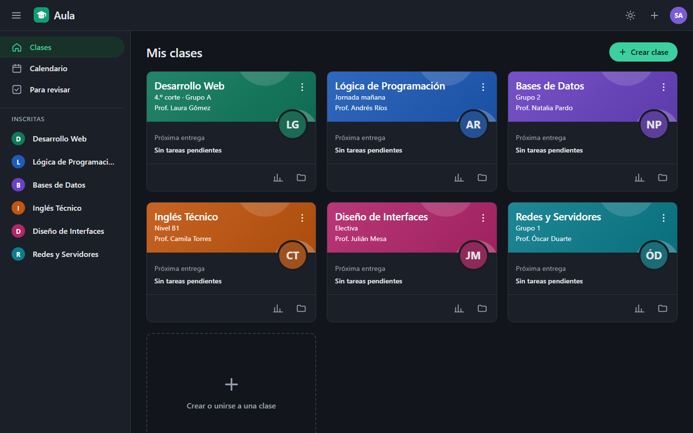

# Aula · interfaz de aula virtual


Proyecto de práctica de maquetación web: una interfaz de aula virtual hecha solo con **HTML, CSS y JavaScript**, sin librerías ni paso de compilación. Empezó en 2023 como un ejercicio de clase para replicar un diseño con HTML y CSS, y luego se reescribió con HTML semántico, diseño responsive, accesibilidad e interacciones con JavaScript.

**Demo:** https://alejo234506.github.io/classroom_1/



## Funcionalidades

- **Mis clases:** cuadrícula de tarjetas con banners de colores, docente y accesos rápidos.
- **Crear clase:** ventana modal (`<dialog>`) con validación; la clase nueva se guarda en `localStorage` y se puede eliminar.
- **Vista de clase con pestañas** *Tablón*, *Trabajo de clase* y *Personas* (patrón ARIA *tabs*, navegación con flechas, Inicio y Fin).
- **Tablón:** publica anuncios que se guardan por clase.
- **Barra lateral** que se oculta en escritorio y se convierte en menú tipo cajón (hamburguesa) en móvil; se cierra con `Esc` o tocando fuera.
- **Modo oscuro** que respeta la preferencia del sistema y recuerda tu elección.
- **Accesibilidad:** enlace para saltar al contenido, `aria-*` en controles, foco visible, uso completo con teclado y soporte de `prefers-reduced-motion`.
- **Navegación por hash** (`#/clase/web/trabajo`), así cada vista tiene su propio enlace.
- Si el navegador bloquea `localStorage` (por ejemplo, en modo privado), la app sigue funcionando sin guardar datos.

## Estructura

```
index.html          Página principal (toda la aplicación)
styles/styles.css   Estilos, temas claro/oscuro y responsive
js/app.js           Lógica: datos, rutas, pestañas, modal y tema
favicon.svg         Logo original de "Aula"
docs/preview.png    Captura para este README
novedades.html      Redirección a la vista Tablón (versión antigua)
trabajo.html        Redirección a Trabajo de clase (versión antigua)
```

## Cómo ejecutarlo

No requiere instalación. Clona el repositorio y abre `index.html` en el navegador:

```bash
git clone https://github.com/alejo234506/classroom_1.git
cd classroom_1
start index.html   # Windows (en macOS: open, en Linux: xdg-open)
```

## Aviso

Proyecto de práctica inspirado en interfaces de aulas virtuales. No afiliado a Google. El nombre "Aula", el logo y los iconos son originales de este proyecto; los nombres de clases y personas son ficticios.
